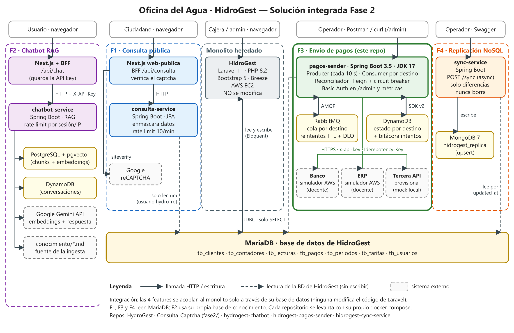

Nombre: Melki Bladimir Ortiz Martinez

Carnet: 0905-23-6329

Repositorio: https://github.com/HydroGest-Team/hidrogest-pagos-sender

Modulo asignado: Envío de pagos a sistemas externos por colas.

# pagos-sender · Feature 3: envío de pagos a sistemas externos por colas

Microservicio **Spring Boot 3.5 (JDK 17)** que toma los pagos cobrados en **HidroGest** (MariaDB,
solo lectura) y los entrega a **3 sistemas externos**: el **Banco** y el **ERP** (simuladores del
docente en AWS) y una **tercera API** (contrato provisional). Usa productor/consumidor sobre
**RabbitMQ**, guarda el estado por destino en **DynamoDB** y reenvía **solo a los destinos que faltan**.

Documentación de apoyo: [Guía completa](docs/GUIA-COMPLETA.md) (qué, cómo, dónde y por qué) ·
[Pruebas con interfaz gráfica](docs/PRUEBAS-GRAFICAS.md) · [Runbook](docs/RUNBOOK.md) ·
[Decisiones (ADR)](docs/adr/) · [Contexto y plan](docs/CONTEXTO_Y_PLAN_FEATURE3_PAGOS.md)

## Contenido

1. [Arquitectura de la solución integrada (Fase 2)](#1-arquitectura-de-la-solución-integrada-fase-2)
2. [Mi módulo: envío de pagos por colas](#2-mi-módulo-envío-de-pagos-por-colas)
   - [2.1 Funcionalidad y objetivo](#21-funcionalidad-y-objetivo)
   - [2.2 Integración y responsabilidades](#22-integración-y-responsabilidades)
   - [2.3 Decisiones técnicas](#23-decisiones-técnicas)
   - [2.4 Cómo probar el módulo](#24-cómo-probar-el-módulo)
3. [Referencia: configuración, build y pruebas automáticas](#3-referencia-configuración-build-y-pruebas-automáticas)

---

## 1. Arquitectura de la solución integrada (Fase 2)



Fuente editable del diagrama: [`docs/arquitectura/arquitectura-fase2.svg`](docs/arquitectura/arquitectura-fase2.svg).

La Fase 2 agrega cuatro funcionalidades nuevas alrededor de un sistema que ya existía, **sin
modificar su código**. Cada funcionalidad vive en su propio repositorio de la organización
[HydroGest-Team](https://github.com/HydroGest-Team) y el punto de integración común es la **base de
datos de HidroGest**.

### Componentes

| Componente | Repositorio | Tecnología | Qué hace |
|---|---|---|---|
| **Monolito heredado: HidroGest** | [HydroGest](https://github.com/HydroGest-Team/HydroGest) | Laravel 11, PHP 8.2, Bootstrap 5, Breeze (sesiones), MariaDB, AWS EC2 | Sistema de la Oficina del Agua: clientes, contadores, tarifas, lecturas y **cobros**. La cajera registra los pagos (`tb_pagos`). No se modifica. |
| **BD de HidroGest** | (la del monolito) | MariaDB | `tb_clientes`, `tb_contadores`, `tb_lecturas`, `tb_pagos`, `tb_periodos`, `tb_tarifas`, `tb_usuarios`. Solo el monolito escribe; las features la leen. |
| **F1 · Consulta pública con captcha** | [Consulta_Captcha](https://github.com/HydroGest-Team/Consulta_Captcha) (`fase2/`) | Next.js (`web-publica`) + Spring Boot (`consulta-service`, JPA) | El ciudadano consulta el estado de cuenta por código de contador. El BFF de Next.js valida el captcha con Google reCAPTCHA en el servidor y llama al servicio, que lee la BD con un usuario de solo lectura, **enmascara** datos personales y limita a 10 consultas por minuto. |
| **F2 · Chatbot con RAG** | [hydrogest-chatbot](https://github.com/HydroGest-Team/hydrogest-chatbot) | Next.js + BFF, Spring Boot (`chatbot-service`), PostgreSQL + pgvector, DynamoDB, Google Gemini | Responde preguntas sobre el servicio usando documentos propios (`conocimiento/*.md`) convertidos en embeddings. El BFF guarda la API key del servicio: el navegador nunca la recibe. Las conversaciones se guardan en DynamoDB. No usa la BD de HidroGest. |
| **F3 · Envío de pagos por colas** (este repositorio) | [hidrogest-pagos-sender](https://github.com/HydroGest-Team/hidrogest-pagos-sender) | Spring Boot, RabbitMQ, DynamoDB, OpenFeign, Resilience4j | Envía cada pago cobrado al Banco, al ERP y a la tercera API, con reintentos, dead-letter y reconciliación. Detalle en la sección 2. |
| **F4 · Replicación asíncrona a NoSQL** | [hidrogest-sync-service](https://github.com/HydroGest-Team/hidrogest-sync-service) | Spring Boot, MongoDB 7 | `POST /sync` lanza una sincronización en segundo plano que copia a MongoDB (`hidrogest_replica`) los registros nuevos o modificados (por `updated_at`) de 6 tablas, con *upsert* y sin borrar nunca. `GET /sync/{jobId}` muestra el avance. |
| **Sistemas externos** | — | — | Simuladores del **Banco** y del **ERP** del docente (AWS API Gateway), **Google reCAPTCHA** (F1), **Google Gemini** (F2). |

### Integración entre componentes

- **Con el monolito:** ninguna feature modifica el código ni el esquema de Laravel. F1, F3 y F4 se
  integran **leyendo** su base de datos: F1 con JPA y un usuario de solo lectura, F3 con JDBC y un
  usuario con permiso solo `SELECT`, F4 con JDBC filtrando por `updated_at`. Lo que la cajera cobra
  en HidroGest aparece en estas features sin cambiar nada en el monolito.
- **Navegador → backend:** en F1 y F2 el navegador habla con un **BFF de Next.js**, que guarda los
  secretos (clave de reCAPTCHA, API key del chatbot) y llama al servicio Spring Boot. El navegador
  nunca toca la base de datos ni ve las llaves.
- **Mensajería:** F3 es la única feature con cola de mensajes (RabbitMQ). Su estado vive en DynamoDB,
  no en la BD del monolito.
- **Datos propios:** F2 tiene PostgreSQL + pgvector y DynamoDB; F3, RabbitMQ y DynamoDB; F4, MongoDB.
  Ninguna escribe en la BD de otra.

### Ejecución de la solución

No hay un `docker-compose` único para las cinco piezas: **cada repositorio se levanta por separado**
con su propio procedimiento, y la integración ocurre a través de la BD de HidroGest.

| Pieza | Cómo se levanta (según su README) |
|---|---|
| HidroGest | `composer install`, `npm install && npm run build`, `php artisan key:generate`, `php artisan migrate:fresh --seed`, `php artisan serve` (MariaDB con XAMPP/Laragon); en producción, AWS EC2 |
| F1 | `docker compose up -d` en `Consulta_Captcha/fase2` (consulta-service `:8081`, web-publica `:3000`) |
| F2 | `docker compose up -d postgres dynamodb-local`, `mvnw spring-boot:run` en `chatbot-service` (`:8080`; `--ingestar` carga los documentos) y `npm install && npm run dev` en `frontend` (`:3000`) |
| **F3 (este repo)** | `docker compose up -d`: levanta todo lo necesario, incluida una **réplica local de la BD de HidroGest** con datos semilla (sección 2.4) |
| F4 | `docker compose up -d` (MongoDB) y la aplicación Spring Boot (`:8081`) apuntando a la BD de HidroGest |

F1, F4 y la herramienta Adminer de este repositorio usan el puerto `8081`. Para correrlas a la vez
en una misma máquina hay que cambiar uno de esos puertos.

---

## 2. Mi módulo: envío de pagos por colas

### 2.1 Funcionalidad y objetivo

**Problema de negocio.** Cuando la cajera de la Oficina del Agua cobra un recibo, ese pago debe
quedar registrado en tres sistemas externos: el **banco** (para conciliar el dinero), el **ERP**
(contabilidad) y una **tercera API**. Esos sistemas fallan a propósito: tardan, responden 5xx, cortan
la conexión o confirman tarde. En cualquier momento uno puede estar caído y no se sabe cuál. Si el
envío se hiciera "a mano" o dentro del monolito, un fallo dejaría pagos sin registrar o **registrados
dos veces**.

**Qué construí.** Un microservicio independiente que:

1. **Detecta** cada pago `PAGADO` en HidroGest (cada 10 s), incluso si se cobró después de creado.
2. Crea en DynamoDB una **entrega por (pago, destino)** y publica **un mensaje por destino** en RabbitMQ.
3. Un **consumer por destino** traduce el pago al formato de cada API (centavos para el banco, texto
   con 2 decimales y período fiscal para el ERP, etc.) y lo envía con OpenFeign.
4. **Clasifica la respuesta**: entregado, reintentar más tarde, desconocido (consultar antes de
   reenviar) o rechazo definitivo (dead-letter).
5. Un **reconciliador** revisa periódicamente lo pendiente y lo que falta, y **reenvía solo a los
   destinos que faltan**.

**Resultado:** cada pago llega **exactamente una vez** a cada destino, aunque haya caídas, timeouts o
reinicios del propio servicio, y en todo momento se puede consultar qué destino lo tiene y cuál no.

```
 HidroGest (MariaDB, SOLO SELECT)
        │  Producer (cada 10 s, cursor por updated_at + traslape)
        ▼
 DynamoDB pagos_entregas ── PENDIENTE por (pago, destino) ──► RabbitMQ pagos.exchange
                                                               │
                  ┌──────────────── pagos.banco / pagos.erp / pagos.tercero (quorum)
                  ▼
           Consumer por destino ──Feign──► Banco · ERP · Tercero
            │  ▲      │
            │  │      └─► DynamoDB: estado + bitácora pagos_intentos
            │  └── pagos.<d>.retry.{5s,30s,2m,10m} (TTL)   ·   pagos.<d>.dlq
            ▼
 Reconciliador (cada 1 min + barrido cada 10 min): reencola solo lo vencido o faltante
```

**Estados de una entrega:** `PENDIENTE → EN_VUELO → ENTREGADO`, con `REINTENTO` (falla transitoria),
`DESCONOCIDO` (timeout: no se sabe si llegó) y `DEAD_LETTER` (rechazo definitivo). Un pago está
**completo** cuando todos los destinos activos están `ENTREGADO`.

**Tabla de decisión** (común a los 3 destinos, por código HTTP y código de error del contrato):

| Respuesta del destino | Decisión |
|---|---|
| `201` · `409 DUPLICATE_PAYMENT` / `DOCUMENTO_DUPLICADO` con el **mismo monto** | Entregado (se guarda el comprobante) |
| `409` con otro monto · `IDEMPOTENCY_KEY_REUSED` · `400` · `403` · `422` | Dead-letter: no se reintenta |
| `429` · `500` · `502` · `503` | Reintento con backoff, respetando `Retry-After` |
| Timeout · `504` · error de red | Desconocido: el siguiente intento **consulta (`GET`) antes de reenviar** |

### 2.2 Integración y responsabilidades

| Se comunica con | Cómo | Por qué esa frontera |
|---|---|---|
| **BD de HidroGest** | JDBC (`NamedParameterJdbcTemplate`), conexión `read-only`, usuario con permiso **solo `SELECT`** | El monolito es de otro equipo y **no se modifica**: ni tablas, ni columnas de "enviado", ni migraciones. Por eso el estado de envío no se guarda ahí. |
| **DynamoDB** | AWS SDK v2; tablas `pagos_entregas`, `pagos_intentos`, `pagos_control` | Guarda qué destino recibió cada pago, los intentos y el cursor del producer. Las escrituras condicionales evitan que dos consumers envíen el mismo pago. |
| **RabbitMQ** | Exchange `pagos.exchange`, cola quorum por destino, colas de espera con TTL y DLQ | Desacopla la lectura de HidroGest del envío y aísla los destinos: si el ERP cae, el banco y el tercero siguen. |
| **Banco y ERP** (simuladores del docente) | HTTPS con OpenFeign; header `x-api-key`; llave estable `EQA-000123` (`Idempotency-Key` en el banco, `documento_origen.numero` en el ERP) | Los contratos OpenAPI del docente son la fuente de verdad: de ellos se generan **solo los DTO** y los clientes Feign se escriben a mano. |
| **Tercera API** | Igual que el banco, contra un mock local con contrato provisional | La API real no se entregó. Está aislada en su adaptador: cuando llegue, solo cambia `destinos/tercero` ([ADR-0006](docs/adr/0006-tercera-api-provisional.md)). |
| **Operador** | `/admin/*` y métricas con Basic Auth; `/actuator/health` público | Permite ver el estado de un pago, reencolar un dead-letter ya corregido y forzar el producer o la reconciliación. |

Otras responsabilidades que se respetan:

- **Sin Lambdas ni SQS:** el consumer escribe directo en DynamoDB y la cola es RabbitMQ, como pide la
  arquitectura de la clase ([ADR-0001](docs/adr/0001-rabbitmq-sin-lambdas.md)).
- **Sin datos sensibles hacia afuera:** nunca se envía el DPI (el NIT va como `CF`), no se registran
  `x-api-key` ni cuerpos completos, y los secretos solo existen en `.env`, que está en `.gitignore`.
- **Arquitectura hexagonal** (`src/main/java/gt/edu/umg/desarrolloweb/pagos/`): `domain/` (modelo y
  puertos, sin Spring), `application/` (producer, consumer, reconciliador, clasificador) e
  `infrastructure/` (`mariadb`, `dynamodb`, `rabbit`, `destinos/{banco,erp,tercero}`, `admin`,
  `config`). El orquestador no conoce ninguna API en particular: habla con `DestinationGateway`.

### 2.3 Decisiones técnicas

**Decisión principal: una entrega y un mensaje por (pago, destino), con el estado en DynamoDB y los
reintentos en colas de espera de RabbitMQ.**
([ADR-0002](docs/adr/0002-estado-en-dynamodb-hidrogest-solo-lectura.md),
[ADR-0003](docs/adr/0003-reintentos-con-colas-ttl.md))

| Alternativa | Por qué no |
|---|---|
| Una columna "enviado" en `tb_pagos` | Obliga a modificar el monolito, y un solo flag no dice **cuál** de los 3 destinos falta. |
| Un mensaje por pago que llama a los 3 destinos | Si uno falla, hay que reintentar el mensaje completo y se **reenvía a los que ya lo tenían**. |
| Reintentar dentro del listener (o con Feign/Resilience4j Retry) | Bloquea al consumer, se pierde si el proceso reinicia y oculta cuántos intentos hubo. |

Con la decisión tomada:

- Cada destino avanza por su cuenta: un destino caído **no frena ni duplica** a los demás. Además, su
  **circuit breaker** evita gastar intentos mientras está abajo.
- El reintento no bloquea: el mensaje espera en `pagos.<d>.retry.<tier>` (5 s, 30 s, 2 min, 10 min) y
  vuelve solo cuando vence su TTL. Al agotar 6 intentos va a la DLQ con la causa registrada.
- La idempotencia es de extremo a extremo: llave estable por pago, escritura condicional en DynamoDB y
  `ack` solo después de persistir. Si el servicio cae entre el `201` y el guardado, el reenvío recibe
  `409 duplicado` y se toma como entregado.

**Otras decisiones** documentadas como ADR:

- **Timeout = "desconocido":** antes de reenviar se consulta al destino con `GET` por la llave, porque
  un timeout no dice si el pago llegó ([ADR-0004](docs/adr/0004-timeout-desconocido-y-consulta.md)).
- **Un duplicado solo cuenta como entregado si coincide el monto.** Las pruebas contra los simuladores
  reales mostraron que el banco responde `DUPLICATE_PAYMENT` aunque el monto sea distinto. Por eso el
  servicio compara el monto registrado y, si difiere, lo manda a dead-letter con `LLAVE_REUTILIZADA`
  ([ADR-0007](docs/adr/0007-duplicado-solo-si-coincide-el-monto.md)).
- **Período fiscal del ERP:** año y mes del período facturado de la lectura pagada
  (`tb_periodos.fecha_apertura`), el mismo valor que reciben el banco y el tercero
  ([ADR-0005](docs/adr/0005-periodo-fiscal-erp.md)).

### 2.4 Cómo probar el módulo

**Requisitos:** Docker Desktop y acceso a internet, porque el Banco y el ERP son los simuladores del
docente en AWS. Para compilar sin Docker: JDK 17 y Maven 3.9+.

**1. Configurar y levantar** (desde la raíz del repositorio):

```bash
cp .env.example .env      # completar TEAM_CODE, BANK_/ERP_BASE_URL, las API keys del equipo y contraseñas locales
docker compose up -d      # RabbitMQ, MariaDB (réplica de HidroGest + semilla), DynamoDB Local, mock del tercero, pagos-sender y las interfaces
docker compose ps         # todo "healthy"
```

El `.env` no está en el repositorio: las llaves de los simuladores las entrega el docente a cada
equipo, y las contraseñas locales se eligen libremente.

**2. Interfaces para probar sin comandos:**

| Interfaz | URL | Uso |
|---|---|---|
| Adminer | http://localhost:8081 | Simular a la cajera. Servidor `mariadb`, usuario `hidrogest_app`, contraseña `HIDROGEST_APP_PASSWORD` del `.env`, base `hidrogest`. |
| DynamoDB Admin | http://localhost:8001 | Estado por destino (`pagos_entregas`) y bitácora (`pagos_intentos`) |
| RabbitMQ | http://localhost:15672 | Colas, reintentos en espera y dead-letter (`RABBIT_USER` / `RABBIT_PASSWORD`) |
| Postman | `docs/postman/` | Colección de 7 carpetas: salud, estado del pago, **verificación directa en el banco y el ERP**, métricas, casos negativos e idempotencia |
| pagos-sender | http://localhost:8080/actuator/health | Salud pública del servicio |

**3. Flujo de prueba principal (pago cobrado → llega a los 3 destinos):**

1. En **Adminer**: *Rutinas* → `simular_nuevo_cobro` → *Llamar* con `p_monto = 120.50`,
   `p_metodo = Efectivo`, `p_pagado = 1`. Anotar el `pago_id`. Por consola equivale a
   `docker/mariadb/nuevo-cobro.sh 120.50 Efectivo`.
2. Esperar unos 10 s.
3. En **Postman**: importar la colección y el entorno de `docs/postman/`, completar en el entorno las
   llaves desde el `.env`, poner `pagoId` = ese id y ejecutar la colección (*Run*).

**Resultado esperado:**

- `GET /admin/pagos/{pagoId}` muestra **BANCO, ERP y TERCERO en `ENTREGADO`**, con sus comprobantes
  (`BNK-…`, `ERP-…`, `THR-…`) y `completo = true`.
- La carpeta 3 consulta **directamente** al banco y al ERP reales por la llave `EQA-<id>` y comprueba
  que tienen **el mismo comprobante** que guardó el servicio. Esto prueba que el pago llegó.
- En DynamoDB Admin hay una fila por destino en `pagos_entregas` y un registro por llamada en
  `pagos_intentos`.

**4. Escenarios de fallo** (paso a paso en [`docs/PRUEBAS-GRAFICAS.md`](docs/PRUEBAS-GRAFICAS.md)):

| Prueba | Cómo | Resultado esperado |
|---|---|---|
| Destino caído | Detener `pagos-third-mock` en Docker Desktop y registrar un cobro | Banco y ERP `ENTREGADO`; tercero en `REINTENTO`. Al encenderlo, se entrega **solo al tercero** |
| Pago cobrado después | `simular_nuevo_cobro(75.00, Debito, 0)` y luego `simular_cobro_tardio(<id>)` | No se envía mientras está pendiente; se envía al cobrarlo |
| Rechazo definitivo | Cobro de `30000.00` (más de Q25,000) | Banco y tercero en `DEAD_LETTER` (`VALIDACION_LOCAL`), sin llamar; ERP `ENTREGADO` |
| Timeout y 503 | `BANK_SIM_SCENARIO=TIMEOUT ERP_SIM_SCENARIO=ERROR_503 docker compose up -d pagos-sender` | Banco `DESCONOCIDO` → consulta → entregado **una sola vez**; ERP reintenta |
| Reinicio | Reiniciar `pagos-sender` | Ningún pago ya entregado se vuelve a enviar |

Última verificación (2026-10-30): la colección de Postman pasó **35 peticiones y 66 aserciones**
contra el banco y el ERP reales, y `mvn clean verify` pasó **80 pruebas** (69 unitarias + 11 de
integración).

---

## 3. Referencia: configuración, build y pruebas automáticas

### Build y pruebas

```bash
mvn clean verify     # genera los DTO de los 3 YAML, compila, 69 unitarias + 11 de integración (Testcontainers: MariaDB, DynamoDB Local)
mvn test             # solo unitarias
mvn -Dit.test=MariaDbPaymentSourceIT failsafe:integration-test   # una prueba de integración
```

Para correr el servicio desde el IDE: `docker compose up -d rabbitmq mariadb dynamodb-local third-api-mock`
y `mvn spring-boot:run` con las variables de `.env` (los hosts por defecto son `localhost`).

### Variables principales (`.env`)

| Variable | Uso |
|---|---|
| `TEAM_CODE` | `EQUIPO_A`…`EQUIPO_D`; debe coincidir con la API key (prefijo de la llave: `EQA-`) |
| `BANK_BASE_URL`, `BANK_API_KEY` | Simulador del banco (header `x-api-key`) |
| `ERP_BASE_URL`, `ERP_API_KEY` | Simulador del ERP |
| `THIRD_BASE_URL`, `THIRD_API_KEY` | Tercera API (en compose: el mock) |
| `DESTINOS_ACTIVOS` | `BANCO,ERP,TERCERO` |
| `*_SIM_SCENARIO` | `X-Simulation-Scenario` (vacío = no se envía) |
| `DB_URL`, `DB_USER`, `DB_PASSWORD` | HidroGest; usuario **solo SELECT** |
| `DYNAMO_ENDPOINT` | Vacío = AWS real; con valor = DynamoDB Local |
| `ADMIN_USER`, `ADMIN_PASSWORD` | `/admin` y métricas (vacío = cerrado) |

Los demás valores (intervalos, tiers de reintento, concurrencia por destino) están en
`src/main/resources/application.yml`, cada uno con su variable de entorno.

### Pendientes que dependen del docente

- **D4** · Quién crea las tablas DynamoDB en AWS (hoy: DynamoDB Local con creación automática).
- **D7** · URL y llave propias del ERP: hoy usa el mismo API Gateway y la misma llave que el banco, y funciona.
- **Tercera API real:** contrato provisional + mock ([ADR-0006](docs/adr/0006-tercera-api-provisional.md)).

Proyecto académico · Desarrollo Web 2026 · UMG Jutiapa.
