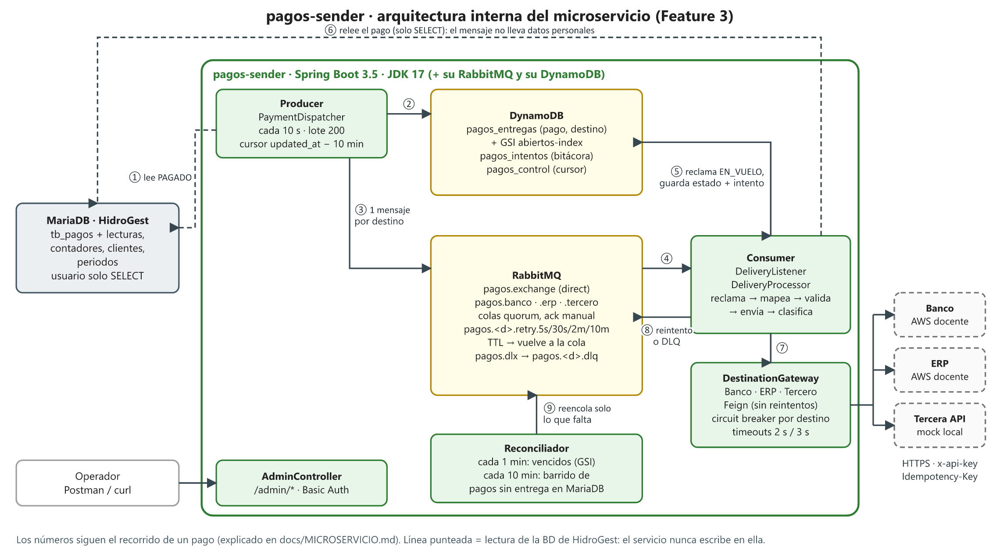

# pagos-sender · documentación del microservicio

Este documento describe **solo** el microservicio de la Feature 3 (envío de pagos a sistemas externos
por colas): cómo está construido por dentro, qué hace cada pieza y cómo se opera. La arquitectura de
toda la solución de la Fase 2 está en el [README principal](../README.md).

## Contenido

1. [Qué hace](#1-qué-hace)
2. [Arquitectura interna](#2-arquitectura-interna)
3. [Recorrido de un pago](#3-recorrido-de-un-pago)
4. [Organización del código](#4-organización-del-código)
5. [Datos que lee de HidroGest](#5-datos-que-lee-de-hidrogest)
6. [Mapeo a cada destino](#6-mapeo-a-cada-destino)
7. [Estado en DynamoDB](#7-estado-en-dynamodb)
8. [Topología de RabbitMQ](#8-topología-de-rabbitmq)
9. [Clasificación de respuestas](#9-clasificación-de-respuestas)
10. [Resiliencia](#10-resiliencia)
11. [API de operación](#11-api-de-operación)
12. [Observabilidad](#12-observabilidad)
13. [Seguridad](#13-seguridad)
14. [Configuración](#14-configuración)
15. [Ejecución y pruebas](#15-ejecución-y-pruebas)

---

## 1. Qué hace

Toma cada pago marcado como `PAGADO` en la base de datos de HidroGest y lo registra en tres sistemas
externos: el **Banco**, el **ERP** y una **Tercera API**. Garantiza que:

- cada pago llegue **una sola vez** a cada destino, aunque haya reintentos o reinicios;
- si un destino falla, **solo ese** se reintenta y los demás no se tocan;
- en todo momento se pueda saber qué destino tiene cada pago y cuál no;
- nada se pierda en silencio: lo que no se puede entregar queda en *dead-letter* con su causa.

| Dato | Valor |
|---|---|
| Tecnología | Spring Boot 3.5, JDK 17, Maven |
| Lee de | MariaDB de HidroGest (solo `SELECT`) |
| Escribe en | DynamoDB (estado propio) y RabbitMQ (mensajes propios) |
| Llama a | Banco y ERP (simuladores del docente en AWS) y Tercera API (mock local) |
| Puerto | `8080` |

---

## 2. Arquitectura interna



Fuente editable: [`arquitectura/pagos-sender-interno.svg`](arquitectura/pagos-sender-interno.svg).

| Componente | Clase principal | Responsabilidad |
|---|---|---|
| **Producer** | `PaymentDispatcher` | Cada 10 s busca pagos `PAGADO` nuevos o cambiados, crea sus entregas y publica los mensajes. |
| **Consumer** | `DeliveryListener` → `DeliveryProcessor` | Un listener por destino. Reclama la entrega, relee el pago, lo mapea, lo valida, lo envía y decide qué sigue. |
| **Gateways** | `BancoGateway`, `ErpGateway`, `TerceroGateway` | Adaptadores de cada API detrás del puerto `DestinationGateway`: cliente Feign, mapper y decodificador de errores. |
| **Clasificador** | `ResponseClassifier` | Convierte cada respuesta HTTP en `DELIVERED`, `RETRY`, `UNKNOWN` o `DEAD_LETTER`. |
| **Política de reintento** | `RetryPolicy` | Elige la cola de espera según el intento y el `Retry-After`. |
| **Reconciliador** | `ReconciliationService` | Reencola entregas vencidas y crea las que falten. |
| **Administración** | `AdminController`, `DeliveryAdminService` | Endpoints `/admin/*` para consultar y operar. |
| **Programación** | `PagosSchedulers` | Dispara el producer y el reconciliador según la configuración. |

---

## 3. Recorrido de un pago

Los números corresponden a las flechas del diagrama.

1. **Detección.** El producer lee de HidroGest los pagos `PAGADO` cuyo `updated_at` es posterior al
   cursor guardado, menos un traslape de 10 minutos. Así detecta también los pagos que se cobran
   después de creados.
2. **Registro.** Por cada pago y cada destino activo crea en DynamoDB una entrega `PENDIENTE`, con
   escritura **condicional** (`attribute_not_exists`). Si ya existía, no hace nada: releer un pago es
   inofensivo.
3. **Publicación.** Solo si la entrega se creó, publica **un mensaje por destino** con *publisher
   confirms*. El mensaje lleva solo `paymentId`, `destino`, `attempt` y `correlationId`, sin datos
   personales.
4. **Consumo.** Cada destino tiene su cola y su listener, con concurrencia propia.
5. **Reclamo.** El consumer pasa la entrega a `EN_VUELO` con un *lease* (escritura condicional). Si
   otro consumer ya la tomó, o ya está `ENTREGADO`, hace *ack* y termina.
6. **Lectura y validación.** Relee el pago de MariaDB, lo traduce al contrato del destino y valida
   monto, fecha, método y llave **antes** de gastar una llamada de red.
7. **Envío.** El gateway llama a la API con la llave estable. Si el intento anterior quedó en
   `DESCONOCIDO`, primero **consulta** (`GET`) por la llave y solo reenvía si el destino no lo tiene.
8. **Decisión.** Guarda el intento en la bitácora y el nuevo estado: `ENTREGADO` con su comprobante,
   `REINTENTO` en una cola de espera, o `DEAD_LETTER` a la DLQ. Hace *ack* **después** de persistir.
9. **Reconciliación.** Cada minuto el reconciliador busca entregas abiertas vencidas o *leases*
   expirados y los reencola. Cada 10 minutos hace un barrido: pagos `PAGADO` sin entrega para algún
   destino activo.

**Estados de una entrega:**

```
PENDIENTE ──► EN_VUELO ──► ENTREGADO              (terminal, nunca se sobrescribe)
                 │
                 ├──► REINTENTO ──► EN_VUELO ...   (falla transitoria: espera en cola TTL)
                 ├──► DESCONOCIDO ──► EN_VUELO ... (timeout: consulta antes de reenviar)
                 └──► DEAD_LETTER                  (rechazo definitivo o intentos agotados)
```

Un pago está **completo** cuando todos los destinos activos están en `ENTREGADO`.

---

## 4. Organización del código

Arquitectura **hexagonal**. Paquete base: `gt.edu.umg.desarrolloweb.pagos`.

```
domain/            Modelo y puertos. Sin Spring, sin HTTP, sin AWS.
  Payment, Destino, EstadoEntrega, Outcome, DeliveryState, DeliveryMessage, PaymentValidator
  Puertos: PaymentSource, DeliveryStateStore, AttemptLog, CursorStore, DeliveryPublisher, DestinationGateway
application/       Casos de uso: orquestan los puertos.
  PaymentDispatcher (producer), DeliveryProcessor (consumer), ReconciliationService,
  ResponseClassifier, RetryPolicy, IdempotencyKeys, DeliveryAdminService, DeliveryMetrics
infrastructure/    Adaptadores.
  mariadb/         MariaDbPaymentSource (JDBC, solo SELECT)
  dynamodb/        Estado, bitácora, cursor y creación de tablas
  rabbit/          Topología, publisher con confirms y listener con ack manual
  destinos/
    banco/ erp/ tercero/   Cliente Feign escrito a mano + mapper + gateway
    common/                Decodificador de errores tolerante, utilidades de montos y texto
  admin/           AdminController
  config/          Seguridad, health de destinos, propiedades
  scheduling/      PagosSchedulers
```

Los **DTO** de cada API se generan de los contratos OpenAPI (`src/main/resources/openapi/*.yaml`)
con `openapi-generator-maven-plugin`, **solo modelos** (`generateApis=false`). Los clientes
`@FeignClient` se escriben a mano. El código generado vive en `target/generated-sources/openapi/` y
no se versiona.

Agregar o quitar un destino no toca el producer, el consumer ni el reconciliador: basta un nuevo
adaptador `DestinationGateway` y la variable `DESTINOS_ACTIVOS`.

---

## 5. Datos que lee de HidroGest

Una sola consulta con *joins* (`MariaDbPaymentSource`):

```
tb_pagos ─► tb_lecturas ─► tb_contadores ─► tb_clientes
                  └──────► tb_periodos
```

- Solo pagos con `estado_pago = 'PAGADO'`, ordenados por `(updated_at, id)` y en lotes.
- La conexión es `read-only` y el usuario de BD tiene permiso **solo `SELECT`**.
- `fecha_pago` no tiene zona horaria: se interpreta en `America/Guatemala`.
- Se lee el DPI del cliente solo porque está en la tabla, pero **nunca se envía**: el NIT va como `CF`.

---

## 6. Mapeo a cada destino

**Llave de idempotencia estable:** `EQA-` + id del pago con 6 dígitos (por ejemplo `EQA-000123`). El
prefijo sale de `TEAM_CODE` (`EQUIPO_A` → `EQA-`). Es la **misma** en todos los intentos y en los tres
destinos. Nunca se usa un UUID por intento.

| Campo | Banco | ERP | Tercera API |
|---|---|---|---|
| Unicidad | header `Idempotency-Key` | `documento_origen.numero` | header `Idempotency-Key` |
| Equipo | `teamCode` | `equipo` | `teamCode` |
| Cliente | `payer.customerCode` = `CLI-0001` | `contribuyente.codigo_cliente` | `customer.code` |
| Nombre | `payer.fullName` (≤ 150) | — | `customer.name` |
| NIT | `payer.taxId` = `CF` | `contribuyente.nit` = `CF` | — |
| Contador | — | `contribuyente.codigo_contador` | — |
| Monto | `amount.valueInCents` (entero, centavos) | `total` (texto, 2 decimales) | `amount` (texto, 2 decimales) |
| Fecha | `transactionDate` | `fecha_pago` y `documento_origen.fecha_emision` | `paidAt` |
| Método | Efectivo → `CASH`; tarjeta → `CARD` | `forma_pago` `EFECTIVO` / `TARJETA` | `method` `CASH` / `CARD` |
| Tipo de documento | — | `RECIBO_CAJA` / `VOUCHER_TARJETA` | — |
| Período | `description` = "Servicio de agua AAAA-MM" | `periodo_fiscal{anio, mes}` | `period` = `AAAA-MM` |
| Detalle | — | 1 línea `AGUA_POTABLE` = total | — |
| Recibo | `metadata.numeroRecibo` | `observaciones` | `reference` |

- El dinero se maneja siempre como `BigDecimal`; la conversión a centavos es exacta, sin `double`.
- El período es el del **período facturado** de la lectura ([ADR-0005](adr/0005-periodo-fiscal-erp.md)).
- **Validaciones previas:** monto mayor que cero; máximo Q25,000.00 para el banco y el tercero (el
  ERP no tiene ese límite); fecha no más de 5 minutos en el futuro; largo de la llave y de la
  referencia según cada contrato. Si fallan, la entrega pasa a `DEAD_LETTER` con código `VALIDACION_LOCAL` sin llamar a
  la API.

---

## 7. Estado en DynamoDB

| Tabla | Clave | Contenido |
|---|---|---|
| `pagos_entregas` | PK `paymentId` (N), SK `destino` (S) | `estado`, `intentos`, `nextAttemptAt`, `leaseUntil`, `idempotencyKey`, `receiptId`, `lastHttpStatus`, `lastErrorCode`, `version`, `openKey` |
| `pagos_intentos` | PK `pk` = `paymentId#DESTINO`, SK `sk` = `timestamp#intento#operacion` | Bitácora: una fila por llamada, con `operacion` (`SEND`/`LOOKUP`), `httpStatus`, `codigoError`, `duracionMs`, `correlationId` |
| `pagos_control` | PK de control | Cursor del producer (`updated_at` del último pago procesado) |

- **Índice disperso `abiertos-index`** (`openKey` + `nextAttemptAt`). `openKey` solo existe mientras
  la entrega no es terminal. El reconciliador consulta lo pendiente sin escanear la tabla.
- **Escrituras condicionales por versión:** dos consumers no pueden enviar la misma entrega y
  `ENTREGADO` nunca se sobrescribe.
- En local las tablas se crean al arrancar (`DYNAMO_CREAR_TABLAS=true`).

Detalle: [ADR-0002](adr/0002-estado-en-dynamodb-hidrogest-solo-lectura.md).

---

## 8. Topología de RabbitMQ

| Elemento | Nombre | Función |
|---|---|---|
| Exchange | `pagos.exchange` (direct) | Enruta por destino |
| Colas principales | `pagos.banco`, `pagos.erp`, `pagos.tercero` | Colas **quorum** durables, *ack* manual, `prefetch` 2 |
| Colas de espera | `pagos.<destino>.retry.{5s,30s,2m,10m}` | Con `x-message-ttl`: al vencer, el mensaje vuelve a la cola principal |
| Dead-letter | `pagos.dlx` → `pagos.<destino>.dlq` | Mensajes que no se pueden entregar; el header `x-pagos-dead-reason` trae la causa |

- El header `x-attempt` cuenta los intentos. Tope: **6** (`MAX_INTENTOS`).
- No hay reintentos ocultos: Feign usa `Retryer.NEVER_RETRY` y el listener tiene el retry desactivado.
  Todo reintento pasa por estas colas y queda registrado.

Detalle: [ADR-0003](adr/0003-reintentos-con-colas-ttl.md).

---

## 9. Clasificación de respuestas

Se decide por **código HTTP y código de error del contrato**, nunca por el texto del mensaje. Los
errores del API Gateway (`{"message": "..."}`) se toleran.

| Respuesta | Resultado | Acción |
|---|---|---|
| `201` | `DELIVERED` | Guarda el comprobante (`BNK-…`, `ERP-…`, `THR-…`) |
| `409 DUPLICATE_PAYMENT` / `DOCUMENTO_DUPLICADO` con el **mismo monto** | `DELIVERED` | Toma el comprobante original |
| `409` duplicado con **otro monto** | `DEAD_LETTER` | Código `LLAVE_REUTILIZADA` ([ADR-0007](adr/0007-duplicado-solo-si-coincide-el-monto.md)) |
| `409 IDEMPOTENCY_KEY_REUSED` / `DOCUMENTO_REUTILIZADO` | `DEAD_LETTER` | Error del productor |
| `400`, `403`, `422` | `DEAD_LETTER` | Validación, configuración o regla de negocio |
| `429`, `500`, `502`, `503` | `RETRY` | Cola de espera ≥ `Retry-After` |
| `504`, timeout, error de red | `UNKNOWN` | Estado `DESCONOCIDO`: el siguiente intento consulta por `GET` |
| `GET` → `200` | `DELIVERED` | El destino ya lo tenía |
| `GET` → `404` | — | No existe: se reenvía con la misma llave |

Detalle: [ADR-0004](adr/0004-timeout-desconocido-y-consulta.md).

---

## 10. Resiliencia

| Situación | Comportamiento |
|---|---|
| Un destino caído | Su **circuit breaker** se abre (50 % de fallos en 10 llamadas, 30 s abierto). Mientras está abierto no se llama a la API y no se gastan intentos. Los otros destinos siguen normales. |
| Destino lento | Timeouts de 2 s (conexión) y 3 s (lectura). La concurrencia es por destino, así que uno lento no frena a los demás. |
| El servicio cae a mitad de un envío | El mensaje no tiene *ack* y RabbitMQ lo reentrega. El destino responde `409 duplicado` y se toma como entregado. |
| Se pierde un mensaje | El reconciliador encuentra la entrega vencida en DynamoDB y la reencola. |
| Reinicio | Apagado ordenado (30 s para terminar lo que está en vuelo). Al volver, nada entregado se reenvía. |
| Pago cobrado tarde | El cursor por `updated_at` con traslape lo detecta. |

---

## 11. API de operación

Todos los endpoints `/admin/*` y las métricas requieren **Basic Auth** (`ADMIN_USER` /
`ADMIN_PASSWORD`). Si `ADMIN_PASSWORD` está vacío, quedan cerrados.

| Método | Ruta | Uso | Respuesta |
|---|---|---|---|
| `GET` | `/actuator/health` | Salud del servicio (público) | `UP` aunque un destino esté caído |
| `GET` | `/actuator/health/destinos` | Salud de cada destino y estado de su circuit breaker | `200` / `503` |
| `GET` | `/admin/pagos/{id}` | Estado por destino, comprobantes y bitácora de intentos | `200`; `404` si no existe |
| `POST` | `/admin/pagos/{id}/destinos/{destino}/reencolar` | Saca una entrega de `DEAD_LETTER` (ya corregida) y la reenvía con la misma llave | `202`; `409` si no estaba en DLQ |
| `POST` | `/admin/producer` | Ejecuta el producer sin esperar los 10 s | `{"encolados": n}` |
| `POST` | `/admin/reconciliar` | Ejecuta la reconciliación ya | `{"reencoladosPorVencimiento": n, "faltantesCreados": m}` |
| `GET` | `/actuator/prometheus` | Métricas | Texto Prometheus |

Colección Postman lista en [`postman/`](postman/): 7 carpetas, 35 peticiones y 66 aserciones.
Procedimientos de operación (DLQ, reconciliación, empezar de cero): [RUNBOOK](RUNBOOK.md).

---

## 12. Observabilidad

**Métricas** (Micrometer, expuestas en `/actuator/prometheus`):

| Métrica | Tipo | Etiquetas | Qué mide |
|---|---|---|---|
| `pagos_intentos_total` | contador | `destino`, `operacion`, `resultado` | Llamadas a cada API y su resultado |
| `pagos_intentos_latencia_seconds` | timer | `destino`, `operacion` | Duración de cada llamada |
| `pagos_entregas_abiertas` | gauge | `destino` | Entregas que aún no son terminales |
| `pagos_entregas_cerradas_total` | contador | `destino`, `estado` | Entregas que llegaron a `ENTREGADO` o `DEAD_LETTER` |
| `pagos_completos_total` | contador | — | Pagos entregados a todos los destinos activos |
| `pagos_dlq_mensajes` | gauge | `destino` | Mensajes en cada DLQ |

**Logs:** cada línea lleva `correlationId`, `paymentId` y `destino` (MDC). El `X-Correlation-Id`
viaja del producer a la cola, al consumer y a la API externa.

**Health:** el grupo `readiness` incluye MariaDB, RabbitMQ y DynamoDB. El grupo `destinos` muestra
cada API externa y su circuit breaker.

---

## 13. Seguridad

- **HidroGest:** solo lectura, usuario con permiso `SELECT`, sin JPA, sin migraciones ni tablas propias.
- **Secretos:** solo en `.env` (en `.gitignore`). `.env.example` lleva valores de relleno.
- **Datos personales:** nunca se envía el DPI. No se registran `x-api-key`, cuerpos completos ni
  datos personales en los logs.
- **Superficie expuesta:** solo `/actuator/health` es público. `/admin/*` y las métricas usan Basic
  Auth y todo lo demás se rechaza. Las respuestas de error no incluyen *stack trace* ni mensaje interno.

---

## 14. Configuración

Todo se configura por variables de entorno (`src/main/resources/application.yml`).

| Variable | Por defecto | Uso |
|---|---|---|
| `TEAM_CODE` | `EQUIPO_A` | Equipo; define el prefijo de la llave |
| `DESTINOS_ACTIVOS` | `BANCO,ERP,TERCERO` | Destinos a los que se envía |
| `BANK_BASE_URL`, `BANK_API_KEY` | — | Banco |
| `ERP_BASE_URL`, `ERP_API_KEY` | la URL del banco | ERP |
| `THIRD_BASE_URL`, `THIRD_API_KEY` | `http://localhost:8089` | Tercera API |
| `BANK_SIM_SCENARIO`, `ERP_SIM_SCENARIO`, `THIRD_SIM_SCENARIO` | vacío | Header `X-Simulation-Scenario` (solo pruebas) |
| `DB_URL`, `DB_USER`, `DB_PASSWORD` | `pagos_ro` | BD de HidroGest (solo `SELECT`) |
| `RABBIT_HOST`, `RABBIT_USER`, `RABBIT_PASSWORD` | `localhost` | RabbitMQ |
| `DYNAMO_ENDPOINT` | vacío = AWS | DynamoDB Local o AWS |
| `DYNAMO_CREAR_TABLAS` | `false` | Crear las tablas al arrancar |
| `PRODUCER_INTERVALO`, `PRODUCER_LOTE`, `PRODUCER_TRASLAPE` | `10s`, `200`, `10m` | Producer |
| `MAX_INTENTOS`, `RETRY_TIERS` | `6`, `5s,30s,2m,10m` | Reintentos |
| `CONSUMER_CONCURRENCIA_BANCO` / `_ERP` / `_TERCERO` | `2` | Consumers por destino |
| `RECONCILIADOR_INTERVALO`, `RECONCILIADOR_BARRIDO` | `1m`, `10m` | Reconciliador |
| `ADMIN_USER`, `ADMIN_PASSWORD` | `admin`, vacío | Acceso a `/admin` y métricas |

---

## 15. Ejecución y pruebas

```bash
cp .env.example .env       # completar llaves y contraseñas
docker compose up -d       # RabbitMQ, MariaDB (réplica + semilla), DynamoDB Local, mock del tercero, servicio, Adminer y DynamoDB Admin
docker compose ps          # todo "healthy"
```

| Interfaz | URL |
|---|---|
| Servicio | http://localhost:8080/actuator/health |
| Adminer (simular a la cajera) | http://localhost:8081 |
| DynamoDB Admin | http://localhost:8001 |
| RabbitMQ | http://localhost:15672 |
| Mock de la tercera API | http://localhost:8089/third/v1/health |

**Pruebas automáticas:** `mvn clean verify` ejecuta 69 pruebas unitarias (mappers, clasificador,
política de reintento, transiciones de estado) y 11 de integración con Testcontainers (MariaDB y
DynamoDB Local).

**Pruebas manuales:** paso a paso en [PRUEBAS-GRAFICAS.md](PRUEBAS-GRAFICAS.md) y en la sección
"Instrucciones para probar el módulo" del [README](../README.md#24-instrucciones-para-probar-el-módulo).

Más detalle (preguntas frecuentes y el porqué de cada decisión): [GUIA-COMPLETA.md](GUIA-COMPLETA.md).
